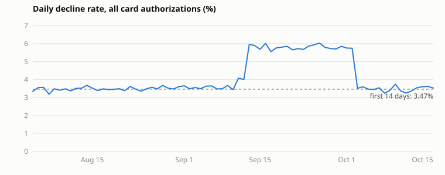

# Data validation (bankwide)

Generated by `make validate-data` (`scripts/validate_bankwide.py`) through the agent's
read-only query path. Bankwide only: segment-level reconciliation with the planted
root cause is done in the Meridian repo and is deliberately not recorded here.

Run `8e0ce02e-b11b-4223-accb-290ec0689cb7`: 2,000,000 authorization attempts, 2026-08-04 to 2026-10-17,
overall decline rate 4.13%. Reference (first 14 days): 3.47%.
Days more than 1.0 pp above the reference: 20, 2026-09-13 to 2026-10-02.

| Check | Result | Detail |
|---|---|---|
| one complete run loaded | PASS | 1 complete run(s) |
| transactions match generation_runs | PASS | 2,000,000 vs 2,000,000 |
| one row per calendar day, no gaps | PASS | 75 days over a 75-day span |
| peak week lifts the decline rate by >= 1.5 pp | PASS | +2.34 pp (95% CI lower +2.22), week of 2026-09-22 |
| final week within 0.5 pp of the reference | PASS | +0.01 pp |

| Week | Attempts | Declined | Decline rate | vs reference |
|---|---:|---:|---:|---:|
| 2026-08-04 to 2026-08-10 | 185,677 | 6,380 | 3.44% | -0.03 pp |
| 2026-08-11 to 2026-08-17 | 186,715 | 6,546 | 3.51% | +0.03 pp |
| 2026-08-18 to 2026-08-24 | 186,686 | 6,456 | 3.46% | -0.01 pp |
| 2026-08-25 to 2026-08-31 | 185,993 | 6,614 | 3.56% | +0.08 pp |
| 2026-09-01 to 2026-09-07 | 186,642 | 6,650 | 3.56% | +0.09 pp |
| 2026-09-08 to 2026-09-14 | 186,272 | 8,028 | 4.31% | +0.84 pp |
| 2026-09-15 to 2026-09-21 | 186,699 | 10,747 | 5.76% | +2.29 pp |
| 2026-09-22 to 2026-09-28 | 185,713 | 10,801 | 5.82% | +2.34 pp |
| 2026-09-29 to 2026-10-05 | 186,752 | 9,210 | 4.93% | +1.46 pp |
| 2026-10-06 to 2026-10-12 | 186,014 | 6,363 | 3.42% | -0.05 pp |
| 2026-10-13 to 2026-10-17 | 136,837 | 4,844 | 3.54% | +0.07 pp |
